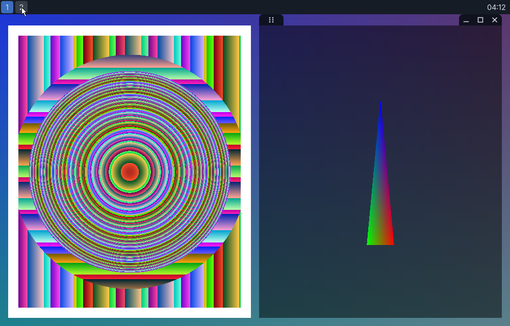

# rei-wm

A Wayland compositor, tiling/floating window manager and small desktop
environment, written in C11. MIT licensed.

**Status: early development.** Milestones 0–11 are done (the DRM/KMS backend
is written but still untested on real hardware: see [docs/DRM.md](docs/DRM.md)): the build, config,
event loop and threading model, the core Wayland protocols, an OpenGL ES
renderer, keyboard/pointer input with a configurable keybinding engine, the
window manager (an i3-style tiling tree with configurable gaps, floating windows,
fullscreen, per-output workspaces), the window notches (a drag handle and
minimize/maximize/close tabs on the focused window), and a built-in toolbar with
workspace buttons and a clock. Real applications can connect, be tiled, and be
driven from the keyboard or mouse. On real hardware it drives displays through
DRM/KMS with libinput, dma-buf clients, direct scanout and a hardware cursor. X11 programs run through Xwayland, tiled and floated like native windows. The config
reloads live, and a Qt settings app edits it. The toolbar shows the PipeWire volume (click to mute, wheel to change) and the media keys
work. Screen capture through PipeWire is still to come: see the roadmap in [docs/ARCHITECTURE.md](docs/ARCHITECTURE.md).



*Unmodified Weston demo clients tiled by rei-wm over a wallpaper, under the toolbar:
workspace buttons at the start (workspace 1 is where you are; the pointer is over 2,
which has a window of its own) and the clock at the end. Windows have no border; the
focused one shows its drag handle and minimize/maximize/close tabs above it.*

## Building

Dependencies (Debian/Ubuntu package names):

```
meson ninja-build pkg-config libwayland-dev wayland-protocols libevent-dev
libegl-dev libgles-dev libxkbcommon-dev xkb-data
libcairo2-dev libpango1.0-dev fontconfig libxcb1-dev
```

For the volume widget and media keys (optional): `libpipewire-0.3-dev`.

For the settings app (optional): Qt 6 (`qt6-base-dev`).

For X11 programs, install `xwayland` (the binary is found at run time).

For the DRM backend (optional): `libdrm-dev libgbm-dev libseat-dev libinput-dev
libudev-dev`.

and at least one font (e.g. `fonts-dejavu-core`) for the toolbar's text.

Rendering uses OpenGL ES 3 through EGL's surfaceless platform, so it needs a
Mesa (or other) GLES driver but no display server; software rendering
(llvmpipe) works.

```bash
meson setup build
ninja -C build
meson test -C build
```

## The toolbar's application tray

The middle three fifths of the toolbar list the open windows, one tile per application (icon and name,
or just the icon: `[toolbar] tray = "icon_and_name" | "icon" | "off"`). Several windows of one
application show as a stack of tiles; clicking it opens a list to pick from. A single window's tile
focuses the window, and hides it again if it already has the focus. Hide windows with the notch's
minimize button or `Mod+m`; a restored window goes back to the same place in the tiling grid (next to
the same neighbour) or, if floating, to the same position.

**Start menu.** A *Start* button sits at the start of the toolbar. It opens a list: your shortcuts
at the top (defined as `[[shortcut]]` entries with a `name` and a `command`), then **Run**, then
**Logout**, **Shutdown** and **Reboot**. The power rows ask first in a confirmation dialog (Enter presses the highlighted button, which starts on Cancel; Tab/arrows move it; Escape cancels; `confirm_power = false`
turns that off), and their commands are configurable under `[start_menu]`. **Run** (or `Mod+r`)
opens a large, see-through command prompt in the middle of the screen: type a command, press Enter
to run it, Escape (or a click) to dismiss. Long commands wrap onto new lines and the box grows,
staying centred; once it reaches 60% of the screen height, no more can be typed. Backspace,
Ctrl+Backspace/Ctrl+W (word) and Ctrl+U (line) edit. Style it with `[theme.run_prompt]` and
`[theme.start_button]`, and the font with `run_font`.

- **Filling up:** as more windows open, tiles shrink in width, down to half their size
  (`tray_min_width`). After that the newest windows go under a "+N" overflow tile, which opens a list
  too. When 32 windows are under it, the next window opens on the next workspace (`tray_scope =
  "workspace"`, the default, lists the current workspace's windows; `"output"` lists every workspace of
  the monitor, with no cap).
- **Hover:** a tile highlights the moment the pointer touches it; half a second later a tooltip with the
  full title (or the list of windows) fades in.
- **Reorder:** drag a tile along the bar to move it; the others make room.
- Only what is running is shown: nothing is pinned. Icons come from your desktop entries and icon theme
  (PNG; SVG-only themes are not read), with a coloured letter tile when none is found. The clock format
  is `[toolbar] clock_format` (any `strftime` string; default `%H:%M:%S`).
- **Look:** colours, corner shapes, transparency and shadows of these elements are a theme; see
  [docs/THEME.md](docs/THEME.md).

## Display sleep

`[general] display_sleep = 5` turns the displays off after that many minutes without keyboard, mouse or touchpad
use (0 never; the General tab of the settings app has it). Any input wakes them: a key press, click or scroll that
wakes the display is swallowed (it must not type or click into what you could not see), while moving the pointer wakes
it and carries on. A program holding an idle inhibitor (`zwp_idle_inhibit_manager_v1`, which video players and browsers
playing video use) keeps the displays on. On the DRM backend the monitors are switched off through the kernel (the
CRTCs are deactivated) and relit by a full modeset on wake; the headless and nested backends only log it. This
is untested on real DRM hardware by the automated tests.

## The battery

If the machine has a battery, the toolbar shows a horizontal battery icon that fills in proportion
to the charge, with the percentage, just before the volume and clock (green with a bolt while
charging, red at 15% or less). It is found in `/sys/class/power_supply`: batteries of type
`Battery` that belong to the machine are combined into one (total charge over total capacity, so
two batteries of different sizes weigh correctly); a wireless mouse's or phone's battery is
ignored. A desktop with no battery shows nothing. `[toolbar] battery = false` turns it off (also on a config reload), and `battery_percent = false` keeps only the
icon; hovering the battery shows the exact percentage, charging state in a tooltip. Hovering the clock shows the full date and
time down to the second, with the time zone. It is
re-read every 30 seconds on a thread of its own. Colours and shape are the `battery` theme element.

## Settings

`rei-settings` is a Qt app for everything in `~/.config/rei-wm/config.toml`: input, windows and
gaps, the toolbar, wallpaper, keybindings and monitors. It edits the file in place (your
comments and layout survive; only the values you change move), checks the result with
`rei-wm --check-config`, and saves atomically. A running rei-wm watches the file and applies
most changes at once (gaps, notch, toolbar, wallpaper, keybindings, keyboard layout, repeat
rate, touchpad settings); `[[output]]` and the backend need a restart. The compositor also
reloads on `SIGHUP`, and keeps the old settings (logging why) if the new file is invalid.

```bash
./build/settings/rei-settings                 # edits ~/.config/rei-wm/config.toml
./build/settings/rei-settings --config my.toml
```

## Running

```bash
# Inside another Wayland session: each output becomes a window.
./build/src/rei-wm

# On real hardware, from a text console (read docs/DRM.md first):
./build/src/rei-wm --backend drm

# Without a display (CI, containers): simulated monitors, no output.
./build/src/rei-wm --backend headless -v
```

Then start any Wayland client against the socket rei-wm prints:

```bash
WAYLAND_DISPLAY=wayland-1 weston-simple-shm
```

**Input.** In the nested backend your parent compositor's keyboard and mouse are
forwarded to rei-wm. The parent sees key combinations first, so `Super+...`
shortcuts are usually swallowed by it: when developing nested, set
`composition_key = "alt"` in the config. In the headless backend, point
`REI_HEADLESS_INPUT` at a FIFO and write events to it (this is how the tests
drive it):

```bash
mkfifo /tmp/rei-in
REI_HEADLESS_INPUT=/tmp/rei-in ./build/src/rei-wm --backend headless &
echo "motion_abs 400 300" > /tmp/rei-in     # also: motion, button, key, axis
echo "key 125 1"          > /tmp/rei-in     # evdev codes: Super down
```

In the headless backend nothing is visible, so ask rei-wm for a screenshot:
`kill -USR2 <pid>` writes a PPM per output to `$REI_SCREENSHOT_DIR` (default
`$XDG_RUNTIME_DIR`). `kill -USR1` forces a redraw.

### Using it

`Mod` is the composition key (Super by default). The defaults follow i3:

| keys | action |
|---|---|
| `Mod+Return` | open a terminal (`$TERMINAL`, else `foot`) |
| `Mod+Shift+q` | close the focused window |
| `Mod+h/j/k/l` | focus left / down / up / right |
| `Mod+Shift+h/j/k/l` | move the window that way |
| `Mod+v` / `Mod+b` | the next window opens stacked / side by side |
| `Mod+Shift+Space` | toggle floating |
| `Mod+f` | toggle fullscreen |
| `Mod+1`…`Mod+0` | go to workspace 1–10 (created if new) |
| `Mod+Shift+1`…`0` | send the window to that workspace |
| `Mod+Tab` / `Mod+Shift+Tab` | cycle focus |
| `Mod+Shift+e` | quit |
| `Mod`+left-drag / right-drag | move / resize a floating window |

**The notches.** The focused window shows two small tabs hovering directly above
its top edge: a drag handle on the left, and minimize, maximize and close on the
right. They are drawn over the space above the window, so showing or hiding them
never resizes anything. Click a button (press and release on it) to use it:
close works; minimize and maximize are placeholders for now. Press and hold the
handle to drag: a floating window just moves, and a tiled one lifts out of the
grid. Drop it on another window to join the grid on the side nearest the pointer
(a blue hint shows where it will land), or on empty space to leave it floating.
Because the tabs hover above the window, tiled windows always keep that much room
above them (the top gap, and the gap between stacked windows, is at least the notch
height), and a floating window can't be dragged so high that its tabs leave the
screen. `notch_height` in `[decoration]` sets the size; 0 turns them off.

**The toolbar** is a strip along one edge of every output (`position` = top, bottom,
left or right): workspace buttons at its start and a clock at its end. Each output's
bar lists that output's workspaces; the one you are on is highlighted (more dimly on
outputs that don't have the focus). Click a button to go to that workspace, scroll
the wheel over the bar to step through them, and hover to highlight. Windows never
use the space the bar takes. See the `[toolbar]` section of the config for the
position, size, font, clock format (`strftime`) and colours; `enabled = false`
removes it.

Workspaces belong to an output and are numbered globally, like i3's. An empty
one disappears when you leave it. Gaps (`gap_outer`, `gap_inner`) and the other
options are in the config; set `new_windows = "float"` to stop tiling new windows,
or `focus_follows_mouse = true` for i3's pointer focus. Dialogs always float.

Keybindings are plain strings in the config, so they can be edited by hand (or
by the settings application later). The defaults are written into the file on
first run:

```toml
[keybindings]
"Mod+Return"    = "exec ${TERMINAL:-foot}"
"Mod+Shift+q"   = "close"
"Mod+Tab"       = "focus_next"
"Mod+Shift+e"   = "none"            # "none" removes a built-in binding
"Mod+F1"        = "exec firefox"    # and you can add your own
"Mod+r"         = "workspace 5"
```

Configuration lives in `~/.config/rei-wm/config.toml` (or
`$XDG_CONFIG_HOME/rei-wm/`). A commented default is written on first run. Use
`rei-wm --check-config` to validate a file, and `--help` for all options.

## Wallpaper groups

The wallpaper is a set of **groups**. A group is one picture, or many that take turns: a list of picture files
and folders (a folder stands for the pictures in it, by name, and is looked at again each time the group moves on).
A group with several pictures changes every `interval` seconds, **ten minutes** by default, set for each group; the
same picture shows on every workspace and output that shows the group.

Which group a workspace shows: the group that lists that workspace in `workspaces`; **every other workspace shows
the "any" group** (`any = true`, and only one group can be it); with no "any" group, the plain background colour.

```toml
[[wallpaper_group]]
name = "Forest"
paths = ["~/Pictures/forest"]        # a folder: its pictures
interval = 300
any = true

[[wallpaper_group]]
name = "Desk"
paths = ["~/Pictures/desk.png"]       # one picture: a group of one
workspaces = [2, 5]
```

In the settings app the **Wallpaper** tab (it used to be "Look") lists the groups as rows. Choose the "any" group with
the radio buttons, write a group's workspaces in the last column, and set how often it changes. **Add picture(s)…**
makes a group from one picture (a group of one) or from several you select with Shift or Ctrl; **Add folder…** makes
one from a folder. The fit mode and background colour are above the table. `[wallpaper] path`, the single picture
of earlier versions, still works and shows up there as one group; the first time you change the groups it is
replaced by `[[wallpaper_group]]` tables. Pictures are drawn at the output's size and kept for a while, so going back
to a workspace costs nothing; one that cannot be loaded is skipped (and said so in the log).

## Wifi and brightness

**Wifi.** If the machine has a wireless interface, a small signal icon sits before the battery (or the volume,
or the clock): the arcs the signal reaches are lit, so it shows how strong the connection is; when there is no
connection it is **red with a strike through**. Clicking it runs `[toolbar] wifi_command` (default `wpa_gui`;
if that is not installed its error appears as a message). It is read from `/sys/class/net` (an interface with
a `wireless` directory is connected when its `operstate` is `up`) and `/proc/net/wireless`, every three
seconds. `[toolbar] wifi = false` hides it; the look is the `[theme.wifi]` element (`color`, `inactive_color`).

**Brightness.** `brightness_up` and `brightness_down` are bound to `XF86MonBrightnessUp` and
`XF86MonBrightnessDown`, the keys laptops send for their brightness buttons (the codes are the same everywhere;
which F-keys those are, F5/F6 on yours, is up to the keyboard, and a key that sends something else can be
bound by hand: `"F6" = "brightness_up"`). Each press changes the backlight by `[brightness] step` percent of its
range (default 5; finer at the dim end, never below 1%), quick presses add up, and the result shows as a single
message ("Brightness: 60%") that updates in place. The backlight is the finest directory under
`/sys/class/backlight` (`device` picks another). Writing it needs permission, so if that is refused rei-wm asks
**logind** to do it for your session (`dbus-send`, which comes with dbus), which needs nothing set up; or give
`[brightness] command` (`"brightnessctl set {percent}%"`, with `{value}`, `{percent}` and `{device}` filled in).

## Focus, the new-window switch and fullscreen

- **Focus follows the pointer** (`[general] focus_follows_mouse`, on by default): hovering a window focuses
  it; moving onto the desktop, the toolbar or a menu leaves nothing focused (keyboard shortcuts such as
  `Mod+q` and `Mod+f` still act on the last window). Set it to `false` for click-to-focus. Hovering **does not
  raise** a floating window: a small dialog (the settings app's colour picker, say) stays in front of its parent
  when the pointer passes over the parent. **Clicking** a window raises it (and so does focusing it from the keyboard).
- **Tiled/floating switch:** the small square after the Start button decides how *new* windows open (a grid
  of panes: tiled; two overlapping windows, lit: floating). It starts from `[layout] new_windows`, and a
  config reload resets it to that.
- **Fullscreen** fills everything beside the toolbar, but keeps the outer gap (`gap_outer`), so the toolbar
  stays visible and usable. Style the confirmation dialog with `[theme.dialog]`.

## CPU/RAM readout and glow

- **CPU and RAM:** one small box just left of the clock shows `CPU 12%   RAM 5.2/16.0GB` (the busy share of all cores,
  and memory used / total in GiB, one decimal), refreshed every two seconds. `[toolbar] sysinfo = false` removes it; style it with
  `[theme.sysinfo]`.
- **Glow:** hovered menu rows, confirmation dialogs and the Run prompt have a white halo. Per element:
  `glow_color`, `glow_size` (pixels; 0 turns it off) and `glow_opacity` under `[theme.menu_row]`,
  `[theme.dialog]` or `[theme.run_prompt]`; any other element can be given one the same way.

## Icons

Three elements are **iconable** (they can show a square icon, at most 64x64, at their front): the tray's
window tiles, the Start button, and every row of the Start menu. Tiles show the application's icon, as
before. Set `[theme] flavor_icons = "/path/to/dir"` and *every* iconable element instead gets a random icon
from that directory (stable for a given element during a session, so icons don't flicker). Only `.png` files
that are **square (1:1) and at most 64x64** are used; anything else is skipped with a warning in the log.
Transparency is respected. Per element, `[theme.tray_tile]`, `[theme.start_button]` or `[theme.menu_row]`
accept `icon = false` (no icon) and `icon_size` (pixels, up to 64; 0 fits the element).

## GTK apps opening in another desktop

If you run rei-wm from a TTY while another desktop of the same user is still running, a single-instance
GTK/GNOME program (GNOME Settings, for example) may find the *other* desktop's copy over the shared D-Bus
session bus and open its window there. `[general] session_bus = "private"` makes rei-wm start its own session
bus for the programs it launches, so they open in rei-wm. The catch: that bus has none of the other desktop's
services (portals, notifications, keyring). The default, `"inherit"`, changes nothing. (Firefox and most
Wayland programs are unaffected; they do not use the bus to find an existing instance.)

## Volume popup and keyboard LEDs

- Click the volume text in the toolbar: a small panel opens with a **speaker button** (click: mute) and a
  **slider** (click or drag to set the volume; the mouse wheel works over it too). It follows the volume
  live, so the media keys move the slider. Click elsewhere or press Escape to close it. The slider spans
  0 to `[audio] max_volume`.
- **Caps/Num/Scroll Lock LEDs** are now lit by rei-wm (on the DRM backend, whoever reads the keyboard
  owns its LEDs). The *mute* key's LED is different: the kernel lights it from the sound card's own
  mute switch, so it follows only if PipeWire applies the mute to the hardware. The log shows
  `audio: toggling mute on ...` and `audio: '...' is now muted/unmuted` to tell whether PipeWire accepted it.

## Starting the sound system (`[audio] autostart`)

On by default. When rei-wm starts it makes sure the sound system is up, starting only what is missing:
`pipewire` (if no PipeWire socket exists), `wireplumber` (if your user has none running; it creates the
sound devices, so without it there is no volume widget) and `pipewire-pulse` (if there is no PulseAudio
socket; Firefox and many others need it). Whatever rei-wm started is stopped when it exits, and anything
already running (for example from another desktop session of yours) is left alone. Set
`[audio] autostart = false` to manage them yourself; the environment variable `REI_AUDIO_AUTOSTART=0|1`
overrides the file. Programs not installed are skipped with a warning in the log.

## Cursors and cursor themes

The pointer changes with what is under it: a text beam over text, a hand over links and buttons, resize arrows
at window edges, a closed hand while a window is dragged, and so on. Programs choose their own shape (through
`wp_cursor_shape_v1`, which Qt, GTK 4 and most modern toolkits use, or by giving rei-wm a picture, as
Xwayland and older toolkits do), and rei-wm picks the shapes for its own widgets: the Start button, the
toolbar's buttons and tray tiles, menu rows, dialog buttons, the notches (hand over the drag handle, a closed
hand while dragging), and a text beam in the Run prompt. A program's choice lasts until the pointer enters
another window.

The theme is any XCursor theme: a folder with a `cursors/` directory, searched for in `~/.local/share/icons`,
`~/.icons`, `/usr/share/icons`, `/usr/share/pixmaps`, `/usr/share/cursors` and `/usr/share/cursors/xorg-x11`
(the latter two are where Gentoo's `x11-themes/*cursors` ebuilds install them), or in `$XCURSOR_PATH` if you set
it. Themes that `Inherits=` another one in their `index.theme` work; shapes a theme lacks fall back to its
arrow, and with no theme at all rei-wm draws a built-in arrow.
Animated cursors (the busy/wait spinner of most themes) play: the frames and their delays come from the
theme file, and the pointer is redrawn (or the hardware cursor re-uploaded) at each step.

```toml
[cursor]
theme = "Adwaita"   # "" = the system default ($XCURSOR_THEME, then "default")
size = 24           # logical pixels; on a scaled screen the picture is chosen to stay sharp
```

Choose it in the settings app's **Cursor** tab (with a preview), or edit the file; the change applies at once.
rei-wm exports `XCURSOR_THEME`, `XCURSOR_SIZE` and `XCURSOR_PATH` to what it starts (and to Xwayland), so X11
programs and toolkits that load the theme themselves match; programs that were already running keep their old
one until restarted. `rei-wm --list-cursor-themes` lists the installed themes and
`rei-wm --cursor-preview out.png --cursor-theme NAME` draws one.

## Text effects and window shaders

Text can glow, blink and shine like metal, drawn by GLSL fragment shaders. Each themed element has the
settings (`text_glow_size`, `text_glow_strength`, `text_glow_tint`, `text_glow_color`, `text_blink`,
`text_shine`, `text_shine_color`), all off by default, in the Theme tab of the settings app under "Text
effects"; the preview there is drawn by the real renderer, so it shows them.

Windows can be drawn through a shader too, as with picom's `--window-shader-fg`. The built-in one, `glow`,
makes a terminal's text bloom, and it is on for urxvt by default (`[theme.window_text]`: the programs it
applies to, the glow's size and strength, or the path of your own GLSL file; "Window text (terminals)" in the
theme editor). `--window-shader-fg SHADER` and `--window-shader-fg-rule SHADER:APP` do the same from the
command line. See [docs/THEME.md](docs/THEME.md) for the details and how to write a shader.

```toml
[theme.toolbar]
text_glow_size = 5

[theme.run_prompt]
text_shine = 1.0

[theme.window_text]
apps = "URxvt, foot"
text_glow_size = 6
```

## Output scale

`[[output]] scale = 2` makes everything on that output twice as large: the toolbar and menus, and
applications, which are told to render at that scale (so text stays sharp; a fractional scale such as
1.5 renders at 2x and is scaled down). Changing `scale` in the config (or in the settings app) now
**applies on reload**, with no restart. Mode, position and enabled still need a restart. X11 programs
(via Xwayland) are not scaled: they keep their pixel size.

A single window buffer may be at most 8192x8192 pixels; a larger one is refused instead of freezing the
machine. Buffers of 32 MiB or more are noted in the log with the client's pid.

### Fractional scale

rei-wm implements `wp_fractional_scale_v1` and `wp_viewporter`. A program that supports them (Firefox, GTK 4,
foot, Qt 6 and others) is told the exact scale (`scale = 1.4` means 1.4, not 2) and draws exactly that many
pixels, so it is sharp; it says what logical size it occupies through the viewport. Programs that do not
support them fall back to the whole-number scale (1.4 -> 2) and are scaled down, which is softer. The viewport's
source rectangle (cropping) is not implemented; only its destination size is.

## The message column

An invisible column of text at the right edge of the screen (or the left: `[messages] position = "left"`).
For now it shows what a command typed into the **Run** prompt prints (stdout and stderr; a command with
no output pushes no message; escape sequences are stripped and long output is cut to 40 lines).

- A new message is shown for `[messages] duration` seconds (default 10) and fades out near the end.
- Each newer message pushes the older ones up and dims them one step, so the oldest on screen is nearly
  invisible (`max_visible`, default 6).
- **Mod+n** (the `messages` action) opens the whole history (`history`, default 200) at full strength on a
  translucent backdrop; the mouse wheel scrolls it; Mod+n or Escape closes it.
- `width` and `font` set the column; the look is the `[theme.messages]` element (`text_color`, the text's
  halo through `shadow_*`, and `color`/`opacity` for the backdrop).

### The top layer (Mod+n) and the music controls

The Mod+n view is a **top layer**. Everything under it is blurred and darkened (`[messages] blur_radius`,
default 12 pixels, 0 for none; `blur_dim`, default 0.3), and **nothing reaches the windows while it is open**:
the pointer leaves the window it was over, clicks, motion and the wheel belong to the view, and every key press
is swallowed (your keybindings and the Ctrl+Alt+F switch still work; a key released after being pressed
before the view opened is still released in its window, so nothing stays held down). Escape, Mod+n, or a
click on the blurred background closes it.

At its bottom centre are the **music controls** for MPD: a "Now playing: ..." label, a row of **previous**, a
single **play/pause** button in the middle (it shows pause while playing, and lights up) and **skip**, and
below it three smaller toggles: **shuffle**, **loop all** (repeat the playlist) and **loop one** (repeat the
song). The two loops exclude each other, and pressing the lit one stops looping. Space also toggles play/pause. If MPD is not running there are no controls, only a
**Start MPD** button, which runs `[mpd] start_command` (default `mpd`) and picks the server up as soon as it
answers. When the song changes, `Now playing: Artist - Title` is added to the messages. The panel keeps clear of
the message column on a narrow screen. The look is the `[theme.mpd]` element (buttons use `start_button`).

```toml
[mpd]
enabled = true
host = ""           # "" = $MPD_HOST, else $XDG_RUNTIME_DIR/mpd/socket, else localhost; an IP address,
                    # localhost or a socket path ("password@host" for a password)
port = 6600
start_command = "mpd"
announce = true     # "Now playing: ..." messages
```

**The volume.** MPD has a volume of its own, which the sound system's does not affect when MPD plays straight to
the card or uses its software mixer, so the media keys could appear to do nothing while it played. They now
follow MPD while it is playing: the keys, the wheel, the toolbar text (shown as `♪ 60%` so it is clear whose
volume it is) and the slider all change it, and a change made from outside (`mpc volume -10`) shows up at
once. MPD has no mute, so the mute key sets it to 0 and the next press puts it back. `[audio] volume_target`:
`"auto"` (default: MPD's while it plays, the sound system's otherwise), `"sink"` (always the sound system's),
`"mpd"` (MPD's whenever it runs) or `"both"` (the sound system's, with MPD set to the same percentage).

rei-wm speaks MPD's protocol itself (no libmpdclient); it keeps one connection waiting for player changes and
looks for MPD every two seconds while it is away. Names other than IP addresses and `localhost` are not looked
up (a lookup would stall the compositor).

## X resources and urxvt transparency

An X session normally runs `xrdb -merge ~/.Xresources` at startup; under rei-wm nothing does, so Xwayland starts
with an empty resource database. rei-wm now does it for you when Xwayland is ready (`[general] xresources =
"~/.Xresources"`, `""` to turn off; needs `xrdb`). True transparency for urxvt works because rei-wm blends
windows that have an alpha channel (a 32-bit visual):

```
URxvt.depth: 32
URxvt.background: [80]#000000
```

(`[80]` is the opacity in percent.) The older "pseudo-transparency" (`URxvt.transparent: true`, `shading`), which
copies the root window's wallpaper, cannot work: a rootless Xwayland has no root pixmap to copy.
