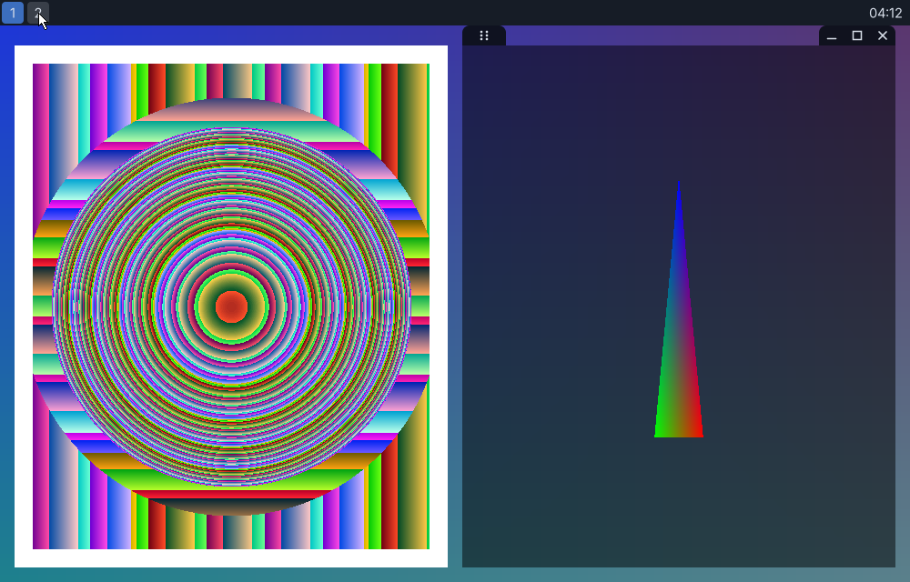

# rei-wm

A Wayland compositor, tiling/floating window manager and small desktop
environment, written in C11. MIT licensed.

**Status: early development.** Milestones 0–11 are done (the DRM/KMS backend
is written but still untested on real hardware: see [docs/DRM.md](docs/DRM.md)): the build, config,
event loop and threading model, the core Wayland protocols, an OpenGL ES
renderer, keyboard/pointer input with a configurable keybinding engine, the
window manager (an i3-style tiling tree with configurable gaps, floating windows,
fullscreen, per-output workspaces), the window notches (a drag handle and
minimize/maximize/close tabs on the focused window), and a built-in toolbar with
workspace buttons and a clock. Real applications can connect, be tiled, and be
driven from the keyboard or mouse. On real hardware it drives displays through
DRM/KMS with libinput, dma-buf clients, direct scanout and a hardware cursor. X11 programs run through Xwayland, tiled and floated like native windows. The config
reloads live, and a Qt settings app edits it. The toolbar shows the PipeWire volume (click to mute, wheel to change) and the media keys
work. Screen capture through PipeWire is still to come: see the roadmap in [docs/ARCHITECTURE.md](docs/ARCHITECTURE.md).



*Unmodified Weston demo clients tiled by rei-wm over a wallpaper, under the toolbar:
workspace buttons at the start (workspace 1 is where you are; the pointer is over 2,
which has a window of its own) and the clock at the end. Windows have no border; the
focused one shows its drag handle and minimize/maximize/close tabs above it.*

## Building

Dependencies (Debian/Ubuntu package names):

```
meson ninja-build pkg-config libwayland-dev wayland-protocols libevent-dev
libegl-dev libgles-dev libxkbcommon-dev xkb-data
libcairo2-dev libpango1.0-dev fontconfig libxcb1-dev
```

For the volume widget and media keys (optional): `libpipewire-0.3-dev`.

For the settings app (optional): Qt 6 (`qt6-base-dev`).

For X11 programs, install `xwayland` (the binary is found at run time).

For the DRM backend (optional): `libdrm-dev libgbm-dev libseat-dev libinput-dev
libudev-dev`.

and at least one font (e.g. `fonts-dejavu-core`) for the toolbar's text.

Rendering uses OpenGL ES 3 through EGL's surfaceless platform, so it needs a
Mesa (or other) GLES driver but no display server; software rendering
(llvmpipe) works.

```bash
meson setup build
ninja -C build
meson test -C build
```

## Settings

`rei-settings` is a Qt app for everything in `~/.config/rei-wm/config.toml`: input, windows and
gaps, the toolbar, wallpaper, keybindings and monitors. It edits the file in place (your
comments and layout survive; only the values you change move), checks the result with
`rei-wm --check-config`, and saves atomically. A running rei-wm watches the file and applies
most changes at once (gaps, notch, toolbar, wallpaper, keybindings, keyboard layout, repeat
rate, touchpad settings); `[[output]]` and the backend need a restart. The compositor also
reloads on `SIGHUP`, and keeps the old settings (logging why) if the new file is invalid.

```bash
./build/settings/rei-settings                 # edits ~/.config/rei-wm/config.toml
./build/settings/rei-settings --config my.toml
```

## Running

```bash
# Inside another Wayland session: each output becomes a window.
./build/src/rei-wm

# On real hardware, from a text console (read docs/DRM.md first):
./build/src/rei-wm --backend drm

# Without a display (CI, containers): simulated monitors, no output.
./build/src/rei-wm --backend headless -v
```

Then start any Wayland client against the socket rei-wm prints:

```bash
WAYLAND_DISPLAY=wayland-1 weston-simple-shm
```

**Input.** In the nested backend your parent compositor's keyboard and mouse are
forwarded to rei-wm. The parent sees key combinations first, so `Super+...`
shortcuts are usually swallowed by it: when developing nested, set
`composition_key = "alt"` in the config. In the headless backend, point
`REI_HEADLESS_INPUT` at a FIFO and write events to it (this is how the tests
drive it):

```bash
mkfifo /tmp/rei-in
REI_HEADLESS_INPUT=/tmp/rei-in ./build/src/rei-wm --backend headless &
echo "motion_abs 400 300" > /tmp/rei-in     # also: motion, button, key, axis
echo "key 125 1"          > /tmp/rei-in     # evdev codes: Super down
```

In the headless backend nothing is visible, so ask rei-wm for a screenshot:
`kill -USR2 <pid>` writes a PPM per output to `$REI_SCREENSHOT_DIR` (default
`$XDG_RUNTIME_DIR`). `kill -USR1` forces a redraw.

### Using it

`Mod` is the composition key (Super by default). The defaults follow i3:

| keys | action |
|---|---|
| `Mod+Return` | open a terminal (`$TERMINAL`, else `foot`) |
| `Mod+Shift+q` | close the focused window |
| `Mod+h/j/k/l` | focus left / down / up / right |
| `Mod+Shift+h/j/k/l` | move the window that way |
| `Mod+v` / `Mod+b` | the next window opens stacked / side by side |
| `Mod+Shift+Space` | toggle floating |
| `Mod+f` | toggle fullscreen |
| `Mod+1`…`Mod+0` | go to workspace 1–10 (created if new) |
| `Mod+Shift+1`…`0` | send the window to that workspace |
| `Mod+Tab` / `Mod+Shift+Tab` | cycle focus |
| `Mod+Shift+e` | quit |
| `Mod`+left-drag / right-drag | move / resize a floating window |

**The notches.** The focused window shows two small tabs hovering directly above
its top edge: a drag handle on the left, and minimize, maximize and close on the
right. They are drawn over the space above the window, so showing or hiding them
never resizes anything. Click a button (press and release on it) to use it:
close works; minimize and maximize are placeholders for now. Press and hold the
handle to drag: a floating window just moves, and a tiled one lifts out of the
grid. Drop it on another window to join the grid on the side nearest the pointer
(a blue hint shows where it will land), or on empty space to leave it floating.
Because the tabs hover above the window, tiled windows always keep that much room
above them (the top gap, and the gap between stacked windows, is at least the notch
height), and a floating window can't be dragged so high that its tabs leave the
screen. `notch_height` in `[decoration]` sets the size; 0 turns them off.

**The toolbar** is a strip along one edge of every output (`position` = top, bottom,
left or right): workspace buttons at its start and a clock at its end. Each output's
bar lists that output's workspaces; the one you are on is highlighted (more dimly on
outputs that don't have the focus). Click a button to go to that workspace, scroll
the wheel over the bar to step through them, and hover to highlight. Windows never
use the space the bar takes. See the `[toolbar]` section of the config for the
position, size, font, clock format (`strftime`) and colours; `enabled = false`
removes it.

Workspaces belong to an output and are numbered globally, like i3's. An empty
one disappears when you leave it. Gaps (`gap_outer`, `gap_inner`) and the other
options are in the config; set `new_windows = "float"` to stop tiling new windows,
or `focus_follows_mouse = true` for i3's pointer focus. Dialogs always float.

Keybindings are plain strings in the config, so they can be edited by hand (or
by the settings application later). The defaults are written into the file on
first run:

```toml
[keybindings]
"Mod+Return"    = "exec ${TERMINAL:-foot}"
"Mod+Shift+q"   = "close"
"Mod+Tab"       = "focus_next"
"Mod+Shift+e"   = "none"            # "none" removes a built-in binding
"Mod+F1"        = "exec firefox"    # and you can add your own
"Mod+r"         = "workspace 5"
```

Configuration lives in `~/.config/rei-wm/config.toml` (or
`$XDG_CONFIG_HOME/rei-wm/`). A commented default is written on first run. Use
`rei-wm --check-config` to validate a file, and `--help` for all options.
