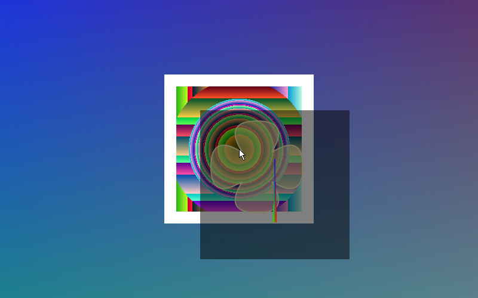

# rei-wm

A Wayland compositor, tiling/floating window manager and small desktop
environment, written in C11. MIT licensed.

**Status: early development.** Milestones 0–4 are done: the build, config,
event loop and threading model, the core Wayland protocols, an OpenGL ES
renderer with alpha blending, wallpaper and a cursor, and keyboard/pointer
input with a configurable keybinding engine, focus handling, clipboard and
window dragging. Real applications can connect, be displayed and be typed into.
There is **no tiling, no workspaces and no decorations** yet, and no real
hardware input (libinput arrives with the DRM backend): see the roadmap in
[docs/ARCHITECTURE.md](docs/ARCHITECTURE.md).



*Three unmodified Weston demo clients (one of them OpenGL) inside rei-wm, over a
wallpaper. Windows are alpha-blended; the arrow is rei-wm's own cursor.*

## Building

Dependencies (Debian/Ubuntu package names):

```
meson ninja-build pkg-config libwayland-dev wayland-protocols libevent-dev
libegl-dev libgles-dev libxkbcommon-dev xkb-data
```

Rendering uses OpenGL ES 3 through EGL's surfaceless platform, so it needs a
Mesa (or other) GLES driver but no display server; software rendering
(llvmpipe) works.

```bash
meson setup build
ninja -C build
meson test -C build
```

## Running

```bash
# Inside another Wayland session: each output becomes a window.
./build/src/rei-wm

# Without a display (CI, containers): simulated monitors, no output.
./build/src/rei-wm --backend headless -v
```

Then start any Wayland client against the socket rei-wm prints:

```bash
WAYLAND_DISPLAY=wayland-1 weston-simple-shm
```

**Input.** In the nested backend your parent compositor's keyboard and mouse are
forwarded to rei-wm. The parent sees key combinations first, so `Super+...`
shortcuts are usually swallowed by it: when developing nested, set
`composition_key = "alt"` in the config. In the headless backend, point
`REI_HEADLESS_INPUT` at a FIFO and write events to it (this is how the tests
drive it):

```bash
mkfifo /tmp/rei-in
REI_HEADLESS_INPUT=/tmp/rei-in ./build/src/rei-wm --backend headless &
echo "motion_abs 400 300" > /tmp/rei-in     # also: motion, button, key, axis
echo "key 125 1"          > /tmp/rei-in     # evdev codes: Super down
```

In the headless backend nothing is visible, so ask rei-wm for a screenshot:
`kill -USR2 <pid>` writes a PPM per output to `$REI_SCREENSHOT_DIR` (default
`$XDG_RUNTIME_DIR`). `kill -USR1` forces a redraw.

Keybindings are plain strings in the config, so they can be edited by hand (or
by the settings application later). The defaults are written into the file on
first run:

```toml
[keybindings]
"Mod+Return"    = "exec ${TERMINAL:-foot}"
"Mod+Shift+q"   = "close"
"Mod+Tab"       = "focus_next"
"Mod+Shift+e"   = "none"            # "none" removes a built-in binding
"Mod+F1"        = "exec firefox"    # and you can add your own
```

Configuration lives in `~/.config/rei-wm/config.toml` (or
`$XDG_CONFIG_HOME/rei-wm/`). A commented default is written on first run. Use
`rei-wm --check-config` to validate a file, and `--help` for all options.
